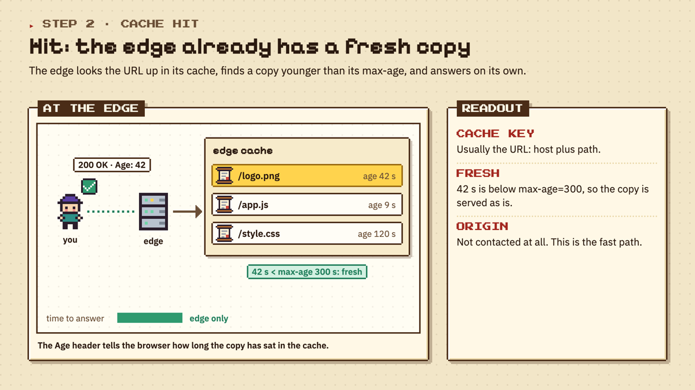
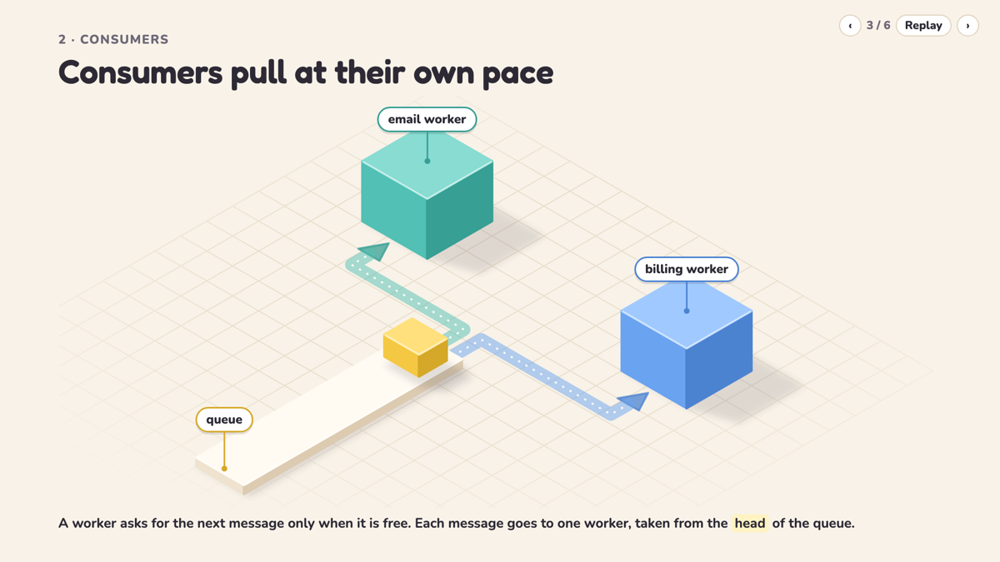
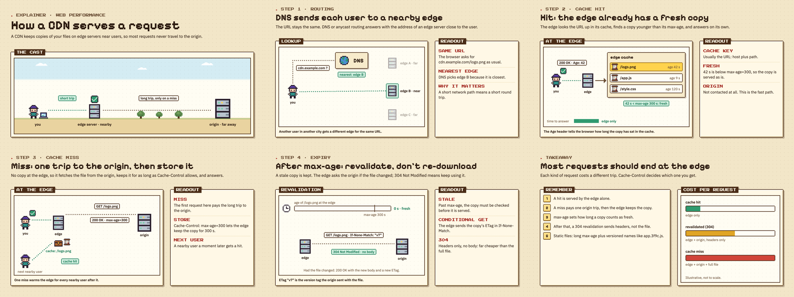
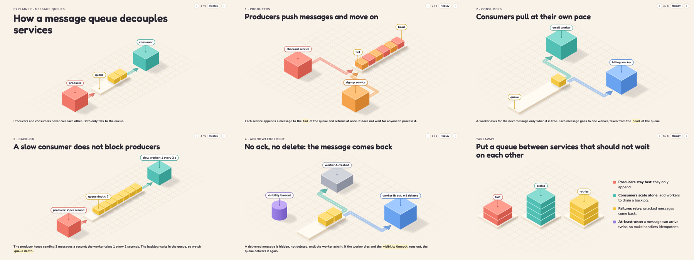

<h1 align="center">Explainer Decks</h1>

<p align="center"><b>Two Agent Skills that make animated explainer slide decks with a look of their own.</b><br>
<code>pixel-deck</code>: a warm 16-bit RPG world. <code>block-deck</code>: isometric toy blocks on a table.<br>
One HTML file per deck, PNG and PDF export, for Claude Code, Codex, Copilot, Cursor and 12 more agents.</p>

<p align="center">
  <a href="https://agentskills.io"></a>
  <a href="LICENSE"></a>
  <a href="#requirements"></a>
  <a href="https://github.com/laulauraluo/explainer-decks/actions/workflows/ci.yml"></a>
</p>

<table>
  <tr>
    <td width="50%"></td>
    <td width="50%"></td>
  </tr>
  <tr>
    <td><sub><b>pixel-deck</b>: parchment, pixel-bordered windows, 23 original sprites, readout panels.</sub></td>
    <td><sub><b>block-deck</b>: one hue per role in three flat tones, tokens moving along floor paths, pinned labels.</sub></td>
  </tr>
</table>

---

## Quick start

```sh
npx skills add laulauraluo/explainer-decks
```

The CLI asks which skill and which agents to set up. Then ask in plain words:

```text
/pixel-deck a 5-slide lightning talk on how HTTPS keeps a login safe, and give me a PDF
```

```text
/block-deck slides for our team meeting: API gateway, three services, a cache and a Postgres
primary with a replica; show a cache hit, a miss served by the replica, and a write
```

You get one `deck.html` you can open, present and edit, a PNG of every slide and a PDF. Codex users type `$pixel-deck` or `$block-deck`; most agents also pick the right skill when you ask for "pixel / retro / 8-bit slides" or "isometric / block / diorama slides".

## Why

Ask an agent for slides and you usually get one of two things: a PowerPoint in a stock theme, or an HTML page that looks like every other HTML page. Neither has a point of view, and neither moves.

These skills give the agent a design system it can commit to, and an engine that makes every slide a small animated scene:

- **A look of its own.** Each skill is a complete visual language, not a colour swap: type, components, scene vocabulary and the rules for using them.
- **One idea per slide, shown, not listed.** Each slide is a scene that plays: a request travels, a cache answers, a queue grows. The final state still explains the idea, so the PDF and reduced-motion viewers get the whole story.
- **Readable from the back of the room.** On the 1920×1080 stage, body text is at least 28 px, captions 24 px, diagram labels 22 px. A built-in check mode (a flag in the URL, run by `shoot.mjs` on every slide) flags anything smaller, overlapping text, clipped text and slides without a title.
- **Checkable.** `#s=4&t=2.5` freezes slide 4 at 2.5 s, so an agent (or you) can screenshot any moment. `shoot.mjs` writes a PNG per slide and a PDF and reports layout problems.
- **Nothing to install.** One self-contained HTML file per deck (only a Google Fonts link is external, with system fallbacks). The scripts use Node's standard library and the Chrome you already have.

## The two styles

### pixel-deck

<p align="center"></p>

[`examples/cdn`](skills/pixel-deck/examples/cdn): *How a CDN serves a request*, 6 slides. Pixelify Sans for headings, Press Start 2P for small labels (where Pixelify's C and O look alike), IBM Plex Sans for body text. A `sprite(rows, palette)` system draws crisp 16-bit sprites from text grids: user, laptop, phone, server, database, cloud, gear, document, lock, key, chest, clock and more.

### block-deck

<p align="center"></p>

[`examples/message-queue`](skills/block-deck/examples/message-queue): *How a message queue decouples services*, 6 slides. Its own small isometric engine: `iso()`, `block()`, `slab()`, `stack()`, `cylinder()`, `floorPath()`, moving `token`s with depth re-sorting, and HTML `tag`s pinned to blocks. Chunky, friendly and colourful on purpose, closer to a board game than a technical drawing.

## How a deck works

```text
skills/<pixel-deck | block-deck>/
├── SKILL.md            workflow, style rules, component API, checks
├── template/deck.html  the engine and style kit in one file: copy it, fill in slides
├── scripts/shoot.mjs   PNG per slide + PDF + layout check, headless Chrome
├── references/style.md palette, proportions, do and don't
└── examples/           a finished demo deck with its shots
```

1. **Outline.** One idea per slide, each with a title that states it.
2. **Scene.** For every slide, pick what moves and what the final state shows. The scene is a function that draws into the slide's SVG and returns `update(t)`.
3. **Build.** Copy `template/deck.html`, replace the sample slides.
4. **Shoot and read.** `node scripts/shoot.mjs deck.html --out shots/` writes `slide-NN.png` at each slide's final state, `deck.pdf`, and a layout report. The agent reads every PNG and fixes what it finds before it reports back.

In the browser: → / Space next, ← back, Home / End, R replays the slide. Print to PDF gives one 16:9 page per slide in its final state.

## Install

| | Command |
|---|---|
| **skills CLI** (any agent) | `npx skills add laulauraluo/explainer-decks` (add `-g` for your user, `-a <agent>` to pick) |
| **Claude Code plugin** | `/plugin marketplace add laulauraluo/explainer-decks`, then `/plugin install explainer-decks@explainer-decks` |
| **Gemini CLI extension** | `gemini extensions install https://github.com/laulauraluo/explainer-decks` |
| **By hand** | copy `skills/pixel-deck/` or `skills/block-deck/` into your agent's skills folder |

Paths and invocation for every agent are in [docs/agents.md](docs/agents.md).

## Requirements

| | Needed for |
|---|---|
| A browser | presenting a deck |
| **Node.js 20+** and **Chrome or Chromium** | `shoot.mjs`: PNGs, PDF and the layout check (set `CHROME_PATH` if Chrome is not in the usual place) |

## Limits

- **Explainer decks, not corporate templates.** There is no master-slide system or brand theming; each skill is one opinionated look.
- **Not PowerPoint.** The output is HTML and PDF. If you must hand in a `.pptx`, export the PNGs and place them, or use a PowerPoint skill.
- **Fonts load from Google Fonts** when online; offline, the system fallbacks are used and the pixel look gets softer.

## Contributing

Issues and pull requests are welcome, especially new sprites, block shapes and example decks. Run `node scripts/check-repo.mjs` and `shoot.mjs` on any deck you change, and attach the PNGs.

## License

[MIT](LICENSE). The fonts are under the SIL Open Font License and are loaded from Google Fonts, not bundled.
