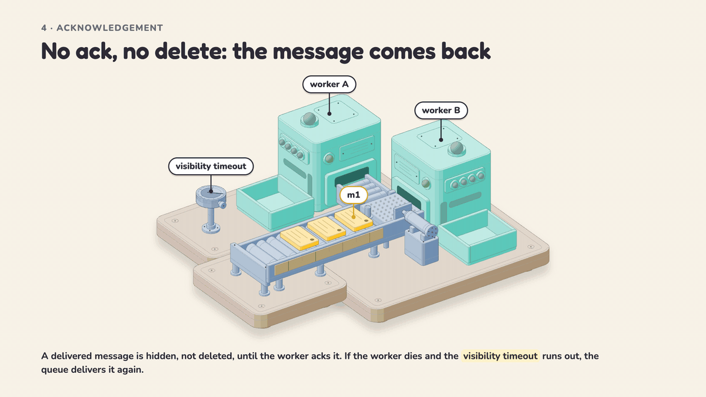
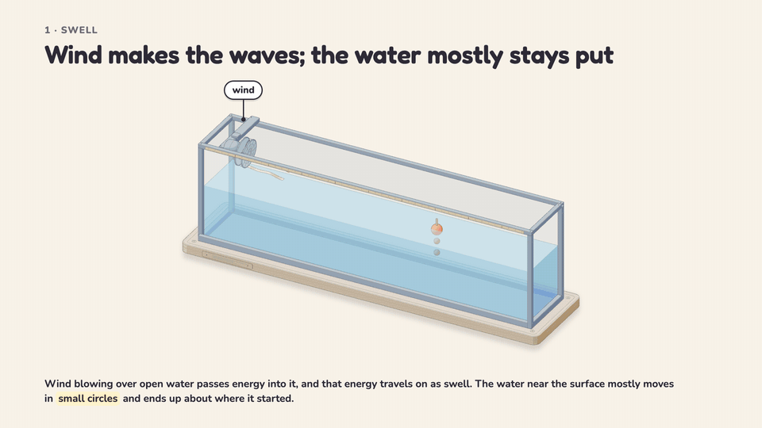
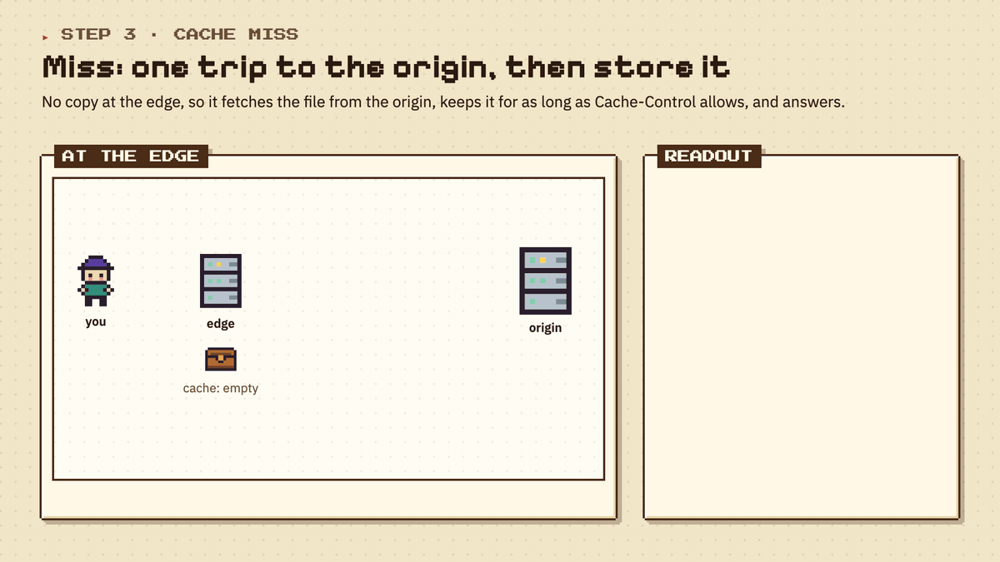
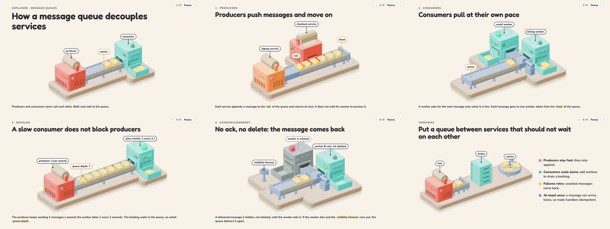

<h1 align="center">Explainer Decks</h1>

<p align="center">
  Agent Skills that turn a technical idea into an animated explainer slide deck: one HTML file, with PNG and PDF export.<br>
  For Claude Code, Codex, GitHub Copilot, Cursor, Gemini CLI and 11 more agents.
</p>

<p align="center">
  <a href="https://agentskills.io"></a>
  <a href="LICENSE"></a>
  <a href="https://github.com/laulauraluo/explainer-decks/actions/workflows/ci.yml"></a>
</p>

<p align="center">
  <picture>
    <source media="(prefers-reduced-motion: reduce)" srcset="assets/workshop-deck-message-queue.png">
    
  </picture>
</p>

<p align="center"><sub>Slide 5 of the <a href="skills/workshop-deck/examples/message-queue">message-queue example</a>, recorded from the deck's own timeline.</sub></p>

```sh
npx skills add laulauraluo/explainer-decks
```

## What you get

- **Two looks, one per skill.** `workshop-deck` draws each concept as a small isometric machine in colour, built on [anatomy](https://github.com/wheresryan22/anatomy). `pixel-deck` is a warm 16-bit RPG world with 23 original sprites.
- **One idea per slide, shown as a scene that plays.** A request travels, a queue fills, a wave breaks. The final state still tells the story, so the PDF and viewers with reduced motion get the whole idea.
- **One self-contained `deck.html`** on a 1920×1080 stage: arrow keys, replay, print to PDF. Only the Google Fonts link is external, with system fallbacks.
- **A PNG of every slide, a PDF and a layout check** from `scripts/shoot.mjs`. It flags text under the size floor (body 28 px, captions 24 px, labels 22 px), clipped or overlapping text, and slides without a title.
- **Frozen frames for review.** `#s=4&t=2.5` holds slide 4 at 2.5 s, so an agent (or you) can screenshot any moment.

## Examples

<table>
  <tr>
    <th width="50%">workshop-deck</th>
    <th width="50%">pixel-deck</th>
  </tr>
  <tr>
    <td>
      <picture>
        <source media="(prefers-reduced-motion: reduce)" srcset="assets/workshop-deck-surfing-tour.png">
        
      </picture>
    </td>
    <td>
      <picture>
        <source media="(prefers-reduced-motion: reduce)" srcset="assets/pixel-deck-cdn.png">
        
      </picture>
    </td>
  </tr>
  <tr>
    <td><sub><a href="skills/workshop-deck/examples/surfing"><b>surfing</b></a>, 8 slides: slides 2 to 7, each playing its own timeline.</sub></td>
    <td><sub><a href="skills/pixel-deck/examples/cdn"><b>cdn</b></a>, 6 slides: slide 4, a cache miss.</sub></td>
  </tr>
  <tr>
    <td></td>
    <td></td>
  </tr>
  <tr>
    <td><sub><a href="skills/workshop-deck/examples/message-queue"><b>message-queue</b></a>, 6 slides, 109 to 168 solid parts per slide.</sub></td>
    <td><sub><b>cdn</b>, all 6 slides.</sub></td>
  </tr>
</table>

## Quick start

Run the `npx skills add` command above; the CLI asks which skill and which agents to set up. Then ask in plain words:

```text
/workshop-deck slides for our team meeting: API gateway, three services, a cache and a Postgres
primary with a replica; show a cache hit, a miss served by the replica, and a write
```

```text
/pixel-deck a 5-slide lightning talk on how HTTPS keeps a login safe, and give me a PDF
```

You get a `deck.html` to open, present and edit, a PNG of every slide and a PDF. In Codex, type `$workshop-deck` or `$pixel-deck`. Most agents also pick the skill on their own when you ask for isometric or machine slides, or for pixel, retro or 8-bit slides.

### Other ways to install

| | Command |
|---|---|
| **skills CLI** (any agent) | `npx skills add laulauraluo/explainer-decks` (`-g` for your user, `-a <agent>` to pick) |
| **Claude Code plugin** | `/plugin marketplace add laulauraluo/explainer-decks`, then `/plugin install explainer-decks@explainer-decks` |
| **Gemini CLI extension** | `gemini extensions install https://github.com/laulauraluo/explainer-decks` |
| **By hand** | copy `skills/workshop-deck/` or `skills/pixel-deck/` into your agent's skills folder |

Paths and invocation for Codex, Copilot, Cursor, Antigravity, OpenCode, Windsurf, Cline, Roo Code, Kiro, Amp, Junie, Zed, Continue and Aider are in [docs/agents.md](docs/agents.md).

## When to use it

**Use it** for a talk, a lesson or a design review where the point is how something works: requests, caches, queues, pipelines, protocols, or a physical process such as a wave breaking. Each slide shows one change over time.

**Use something else** when you need a `.pptx`, a company template, slides that are mostly charts and tables, or one figure for a doc or blog post.

| | Best for | Output |
|---|---|---|
| **workshop-deck** | Architecture and system-design talks, concept walkthroughs, anything with parts that act on each other | HTML deck, PNG per slide, PDF |
| **pixel-deck** | Lightning talks and teaching, where a playful look helps; step-by-step flows between a few actors | HTML deck, PNG per slide, PDF |
| [**anatomy**](https://github.com/wheresryan22/anatomy) | A single interactive isometric figure for docs, a blog or a landing page. workshop-deck builds on it for slides | SVG / HTML figure, optional A4 PDF |
| **A PowerPoint skill** | Decks to hand in as `.pptx`, corporate templates, chart-heavy reporting | `.pptx` |

Between the two skills here: workshop-deck draws more detail per slide (the examples use 34 to 252 solid parts per slide) and suits a technical audience; pixel-deck is lighter, quicker to read, and works well when the actors are people and servers.

## How a deck works

```text
skills/<workshop-deck | pixel-deck>/
├── SKILL.md            workflow, style rules, component API, checks
├── template/deck.html  the engine and style kit in one file: copy it, fill in slides
├── scripts/shoot.mjs   PNG per slide + PDF + layout check, headless Chrome
├── references/         style.md; workshop-deck adds anatomy's craft notes
├── kit/                workshop-deck only: anatomy's isometric kit and its licence
└── examples/           finished demo decks with their shots
```

1. **Outline.** One idea per slide, each with a title that states it.
2. **Scene.** For every slide, decide what moves and what the final state shows. The scene draws into the slide's SVG and returns `update(t)`.
3. **Build.** Copy `template/deck.html` and replace the sample slides.
4. **Shoot and read.** `node scripts/shoot.mjs deck.html --out shots/` writes `slide-NN.png` at each slide's final state, `deck.pdf` and a layout report. The agent reads every PNG and fixes what it finds before it reports back.

In the browser: → or Space for next, ← for back, Home and End, R to replay the slide. With `prefers-reduced-motion`, each slide shows its final state without playing.

## Requirements

| | Needed for |
|---|---|
| A modern browser | presenting a deck |
| **Node.js 20+** and **Chrome or Chromium** | `shoot.mjs`: PNGs, PDF and the layout check (set `CHROME_PATH` if Chrome is not in the usual place) |

## Limits

- **Explainer decks, not corporate templates.** There is no master-slide system or brand theming; each skill is one opinionated look.
- **Not PowerPoint.** The output is HTML and PDF. If you must hand in a `.pptx`, place the PNGs in a deck or use a PowerPoint skill.
- **Fonts load from Google Fonts** when online. Offline, system fallbacks are used and the pixel look gets softer.
- **Quality depends on the agent.** The skills give rules, parts and checks; a deck with many moving machines still takes a capable model and a few rounds of reading the shots.

## Contributing

Issues and pull requests are welcome, especially new machine parts, sprites and example decks. Run `node scripts/check-repo.mjs` and `shoot.mjs` on any deck you change, and attach the PNGs. The GIFs in this README are recorded with `node scripts/capture-gifs.mjs` (needs Node 22+, Chrome and ffmpeg), which steps each slide's timeline frame by frame with `#s=N&t=T`.

## Credits

workshop-deck is built on **[anatomy](https://github.com/wheresryan22/anatomy)** by Ryan (MIT), a skill for crafted isometric SVG figures. It bundles anatomy's isometric kit unchanged (`skills/workshop-deck/kit/iso-kit.mjs`, `lathe.mjs`, with its licence in `kit/LICENSE-anatomy`) and adapts its craft rules and workflow (`references/craft.md`, `kit.md`, `motion.md`, `verify.md`, `walkthrough.md`, each marked at the top). What workshop-deck adds: a colour system per role on the kit's tone ramp, the 16:9 slide engine with frozen frames, print to PDF and the layout check, reusable machine parts, and scenes sized for slides. If you want single interactive figures for docs or a blog rather than slides, use anatomy itself.

## License

[MIT](LICENSE). The bundled anatomy kit is MIT as well, under its own copyright ([kit/LICENSE-anatomy](skills/workshop-deck/kit/LICENSE-anatomy)). The fonts are under the SIL Open Font License and are loaded from Google Fonts, not bundled.
